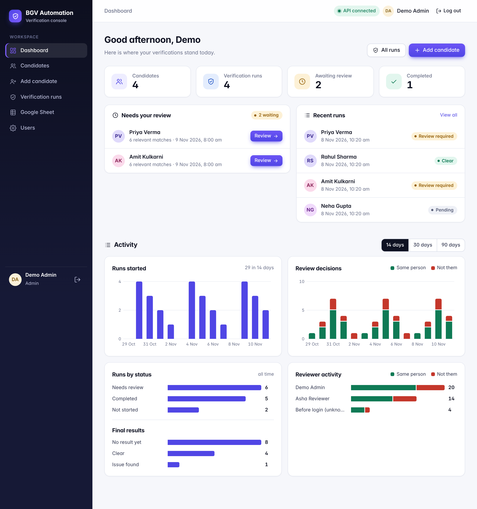
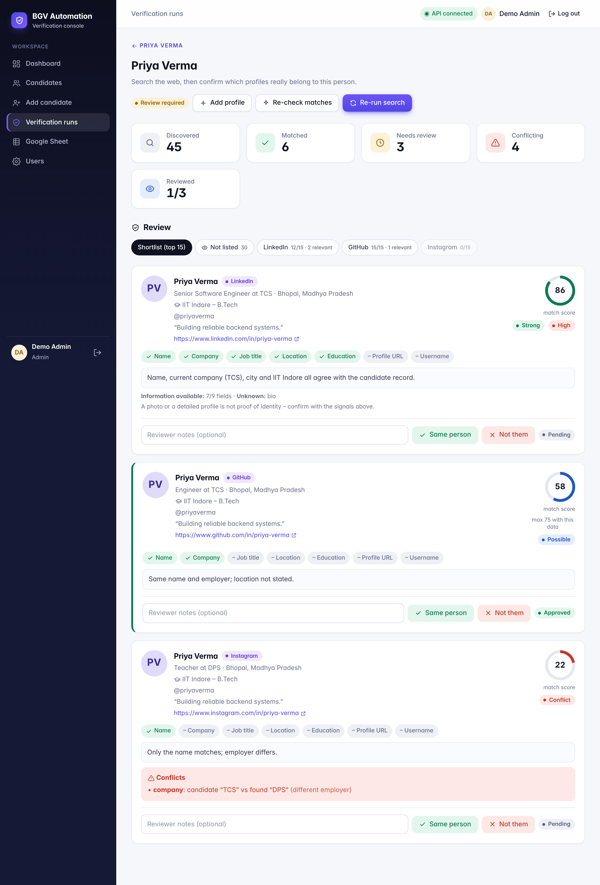
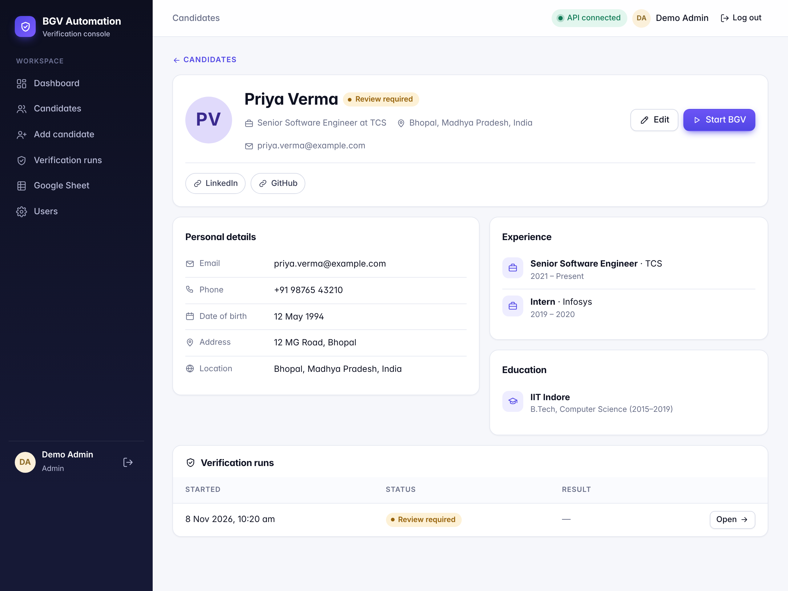
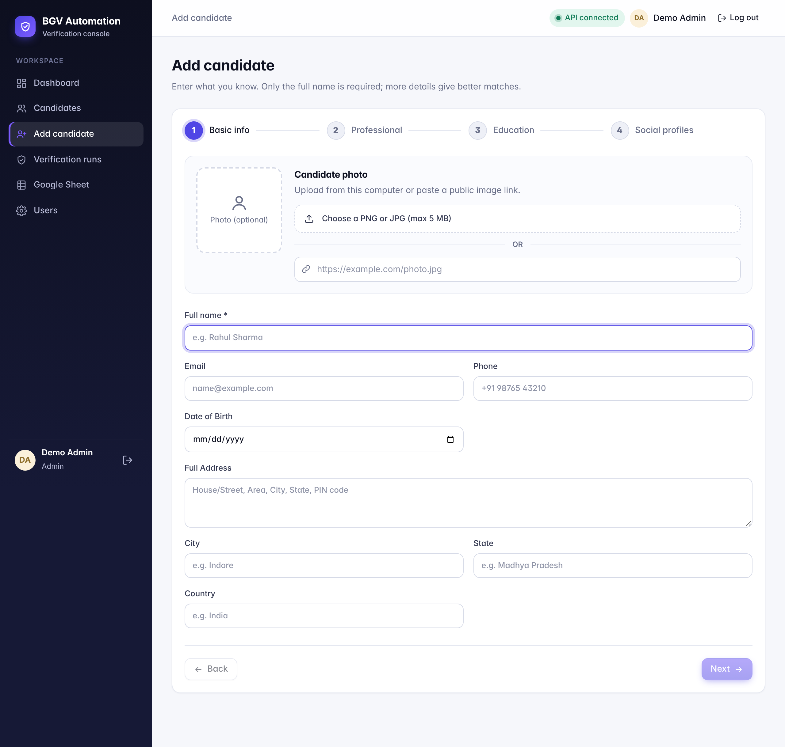
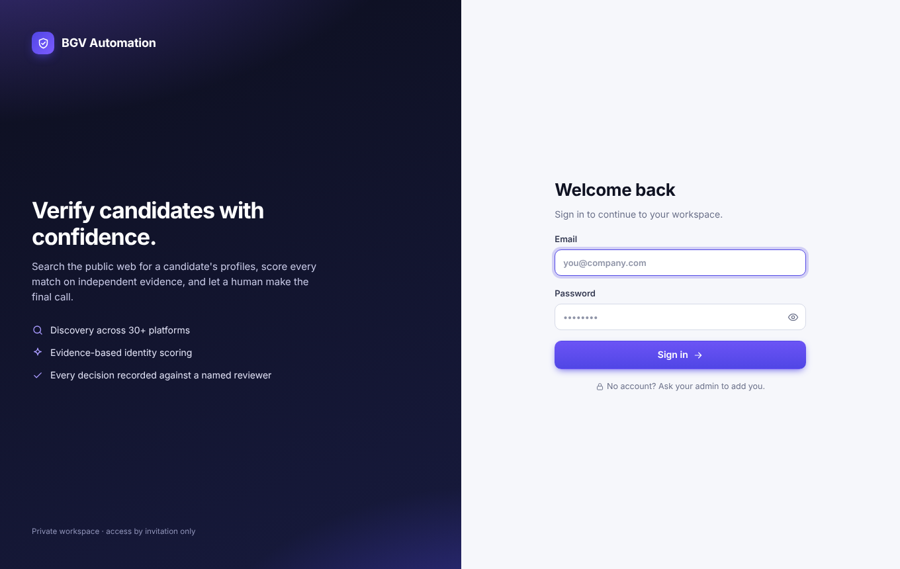
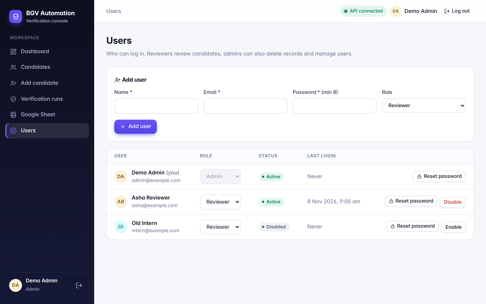
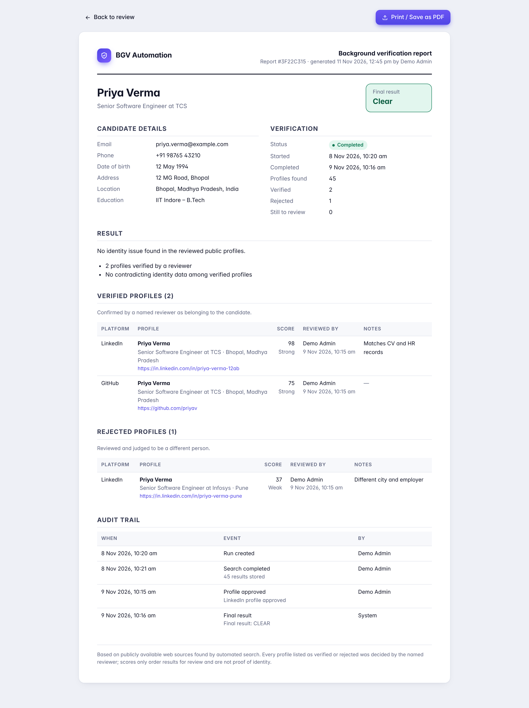
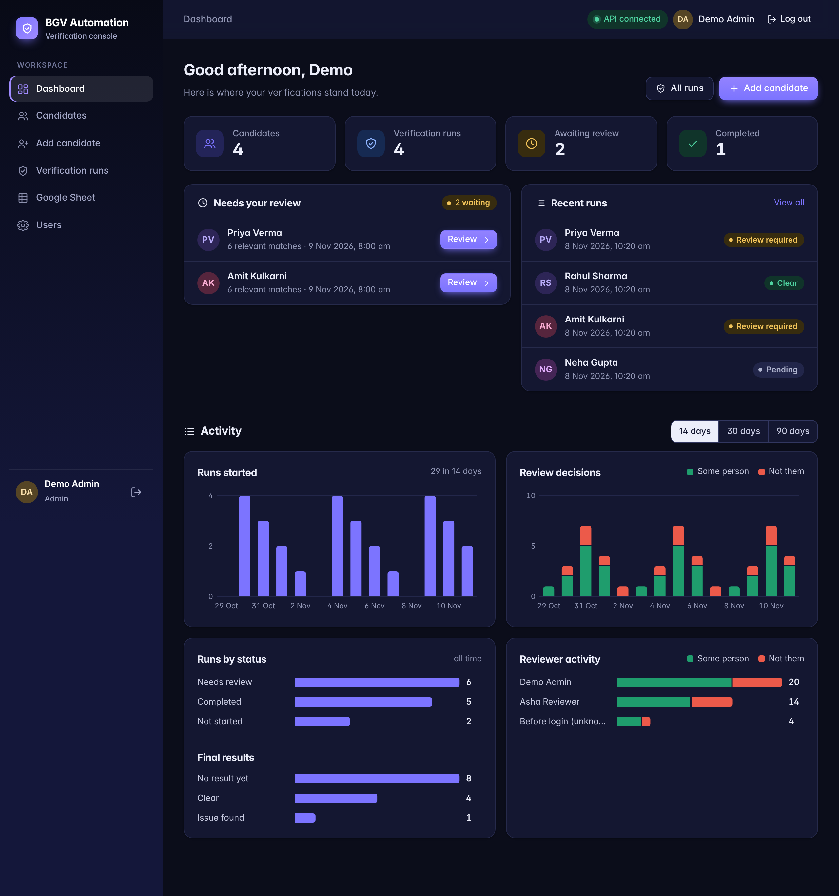
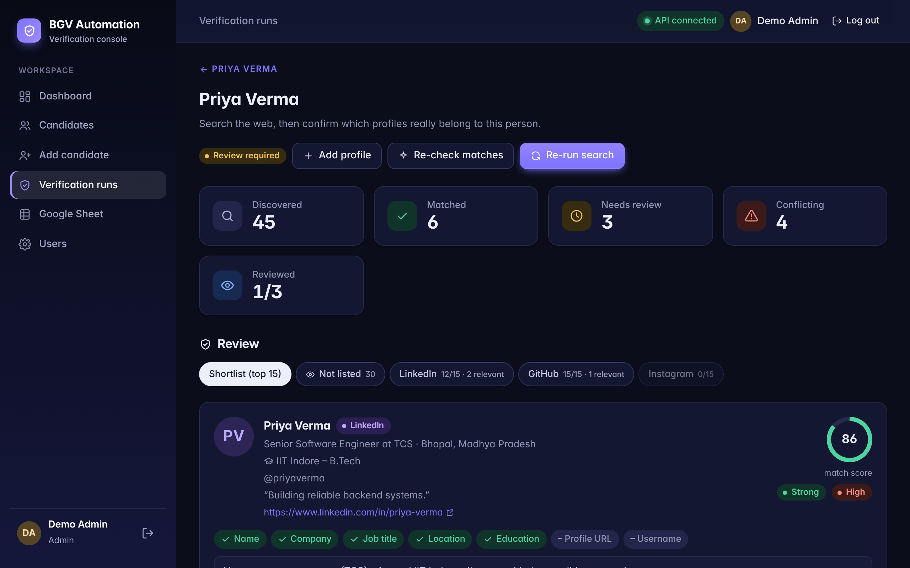
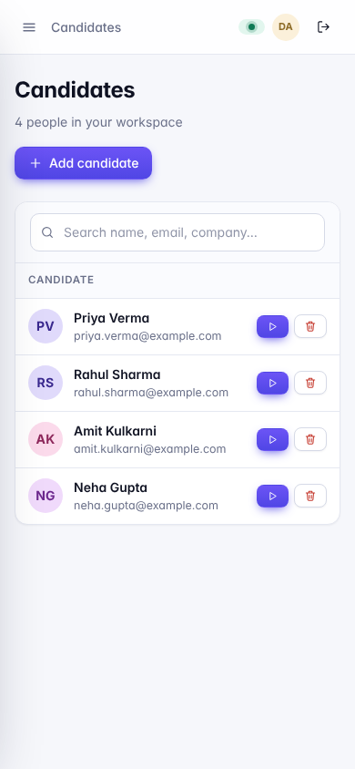

# BGV Automation

Background verification with a human in the loop. Give the app a candidate (name, company, city, education, known profile links), and it:

1. searches the public web for that person's profiles on 30+ platforms (LinkedIn, GitHub, X, Instagram, Facebook, Stack Overflow, Kaggle, …),
2. reads each result, scores how likely it is to be **the same person** using independent evidence (not just the name),
3. shows a ranked shortlist where a reviewer confirms **Same person** or **Not them**,
4. keeps every decision in an audit trail and remembers verified profiles for the next run.

Nothing is ever approved automatically. The score only decides what a human looks at first.



---

## Contents

- [Screenshots](#screenshots)
- [Features](#features)
- [Tech stack](#tech-stack)
- [Project structure](#project-structure)
- [Quick start](#quick-start)
- [Configuration](#configuration)
- [Login, users and roles](#login-users-and-roles)
- [Using the app](#using-the-app)
- [How matching works](#how-matching-works)
- [Google Sheet import](#google-sheet-import)
- [API overview](#api-overview)
- [Tests and benchmarks](#tests-and-benchmarks)
- [Performance and cost controls](#performance-and-cost-controls)
- [Deploy on Render](#deploy-on-render)
- [Troubleshooting](#troubleshooting)

---

## Screenshots

_All screenshots use made-up demo data._

**Review a verification run**: score ring, matching details, conflicts and the Same person / Not them decision.



| Candidate profile | Add candidate |
|---|---|
|  |  |

| Login | Users (admin) |
|---|---|
|  |  |

| Printable report (Save as PDF) | Dashboard activity charts |
|---|---|
|  |  |

| Dark mode | Phone |
|---|---|
|  |  |

## Features

- **Candidate management**: add candidates by hand (with an optional photo), import them from a Google Sheet, edit missing details.
- **Web discovery**: Tavily and Serper search, per-platform discovery with its own target and counters, de-duplication of the same profile URL in any spelling.
- **Profile enrichment**: public, login-free sources only (GitHub API, public page metadata). Restricted platforms are marked as such.
- **Evidence-based matching**: name, current employer, city, job title and education are compared field by field. Missing data is *unknown*, never a mismatch. Namesakes with contradicting data are flagged as `CONFLICT`.
- **Semantic similarity**: an optional BGE-M3 service (Python) re-ranks results; if it is down, ranking falls back to the rule-based score.
- **Human review**: shortlist (top 15), per-platform tabs, a "not listed" view that shows *why* each other result was left out, and an **Add profile** form for profiles you already know.
- **Verified identity registry**: an approved profile is remembered for the candidate and is not asked again on the next run. A changed profile is sent back for re-review.
- **Login and roles**: every API call needs a login. Admins manage users and can delete records; reviewers review.
- **Audit trail**: every run, search, decision and change is logged against the logged-in reviewer.
- **Verification report**: a printable report per run (candidate details, final result, verified and rejected profiles with reviewer, time and notes, audit trail). Use the browser's *Print → Save as PDF*.
- **Dashboard charts**: runs per day, review decisions per day, runs by status and final result, and decisions per reviewer for the last 14 / 30 / 90 days.
- **Modern UI**: light and dark mode, works on phones.

## Tech stack

| Part | Technology |
|---|---|
| Backend | Node.js, Express 5, MongoDB (Mongoose 9), JWT auth |
| Search | Tavily API, Serper (Google) API |
| Images | Cloudinary |
| ML service | Python, FastAPI, sentence-transformers (`BAAI/bge-m3`) |
| Frontend | React 19, Vite, React Router |
| Tests | `node:test`, mongodb-memory-server |

## Project structure

```
Background_verification_software/
├── Backend/
│   ├── server.js                 # starts the API (checks JWT_SECRET, connects MongoDB)
│   ├── app.js                    # Express app: CORS, auth, routes, error handling
│   ├── controllers/              # request handlers
│   ├── routes/                   # URL → controller
│   ├── models/                   # Mongoose schemas (Candidate, BgvRun, SearchResult, CandidateMatch, User, …)
│   ├── services/                 # the real work
│   │   ├── candidateSearch.service.js       # search pipeline (discovery → targeted → per platform)
│   │   ├── resultMerge.service.js           # parse + merge provider results (name, company, title, location, education)
│   │   ├── matchSignals.service.js          # field comparisons (names, companies, titles, locations, education)
│   │   ├── candidateMatch.service.js        # identity score + status (STRONG / POSSIBLE / …)
│   │   ├── candidateMatchRanking.service.js # shortlist, ranking, exclusions with reasons
│   │   ├── profileEnrichment.service.js     # public, login-free enrichment
│   │   ├── verifiedIdentity.service.js      # registry of verified profiles
│   │   └── sheetImport.service.js           # Google Sheet import + sequential search queue
│   ├── middleware/               # auth (JWT, roles), image upload
│   ├── ml-service/               # BGE-M3 similarity service (FastAPI)
│   ├── tests/                    # node:test suites
│   ├── benchmark/                # offline benchmarks with mocked providers
│   └── scripts/                  # maintenance scripts
└── Frontend/
    └── src/
        ├── pages/                # Dashboard, Candidates, Candidate detail, Add candidate,
        │                         # Runs, Run review, Google Sheet, Users, Account, Login
        ├── components/           # UI kit, icons, known-profiles panel
        ├── layout/               # sidebar, top bar
        ├── auth/                 # login state
        └── api/client.js         # all API calls (adds the login token)
```

---

## Quick start

### Requirements

- **Node.js 20+** and npm
- **MongoDB**: a local server (`mongodb://127.0.0.1:27017/bgv`) or a free MongoDB Atlas cluster
- **API keys**: [Tavily](https://tavily.com) and/or [Serper](https://serper.dev) for search, [Cloudinary](https://cloudinary.com) for photo uploads (optional)
- **Python 3.10+**: only for the optional ML similarity service

### 1. Backend

```bash
cd Backend
npm install
cp .env.example .env        # Windows PowerShell: Copy-Item .env.example .env
```

Open `Backend/.env` and fill in at least:

```env
MONGO_URI=mongodb://127.0.0.1:27017/bgv
TAVILY_API_KEY=...
SERPER_API_KEY=...

JWT_SECRET=<long random string>
ADMIN_EMAIL=you@example.com
ADMIN_PASSWORD=<min 8 characters>
CORS_ORIGIN=http://localhost:5173
```

Generate a `JWT_SECRET`:

```bash
node -e "console.log(require('crypto').randomBytes(48).toString('hex'))"
```

Start the API:

```bash
npm start                   # or: npm run dev  (restarts on file changes)
```

You should see:

```
MongoDB connected successfully ✅
First admin created: you@example.com
Server running on http://localhost:5000
```

The first admin is created only once, while there are no users. You can then remove `ADMIN_PASSWORD` from `.env`.

### 2. Frontend

```bash
cd Frontend
npm install
npm run dev
```

Open **http://localhost:5173** and log in with `ADMIN_EMAIL` / `ADMIN_PASSWORD`.

> `localhost:5000` is the API only. Opening it in a browser shows `Route not found`, which is expected. The app is on port **5173**.

To point the frontend at another API address, create `Frontend/.env` with `VITE_API_URL=http://your-host:5000/api`. For production run `npm run build` and serve `Frontend/dist`.

### 3. ML similarity service (optional)

```bash
cd Backend/ml-service
pip install -r requirements.txt
uvicorn app:app --port 8001
```

The first start downloads the `BAAI/bge-m3` model (about 2 GB). Set `ML_SERVICE_URL=http://127.0.0.1:8001` in `Backend/.env`. Without it, everything still works and ranking uses the rule-based score.

### Daily use

Two terminals: `npm start` in `Backend`, `npm run dev` in `Frontend`, then open `http://localhost:5173`.

---

## Configuration

All backend settings live in `Backend/.env`; `Backend/.env.example` lists every option with its default.

### Required

| Variable | Meaning |
|---|---|
| `MONGO_URI` | MongoDB connection string |
| `JWT_SECRET` | secret for login tokens, at least 32 characters; the server will not start without it |
| `TAVILY_API_KEY` / `SERPER_API_KEY` | search providers (at least one) |

### Login and security

| Variable | Default | Meaning |
|---|---|---|
| `ADMIN_EMAIL`, `ADMIN_PASSWORD`, `ADMIN_NAME` | – | first admin, created only while no users exist |
| `CORS_ORIGIN` | `http://localhost:5173` | browser origins allowed to call the API (comma list) |
| `JWT_EXPIRES_IN` | `12h` | how long a login lasts |
| `LOGIN_RATE_LIMIT` | `10` | failed logins per IP per 15 minutes |

### Optional services

| Variable | Meaning |
|---|---|
| `CLOUDINARY_CLOUD_NAME`, `CLOUDINARY_API_KEY`, `CLOUDINARY_API_SECRET` | photo upload on "Add candidate" |
| `ML_SERVICE_URL` | BGE-M3 service, e.g. `http://127.0.0.1:8001` |
| `GITHUB_TOKEN` | raises the GitHub API rate limit for enrichment |
| `GOOGLE_SHEET_ID`, `GOOGLE_SERVICE_ACCOUNT_JSON`, … | Google Sheet import, see [below](#google-sheet-import) |

Search, matching and performance tuning variables (`PLATFORM_*`, `SEARCH_*`, `MATCH_*`, `ML_*`, …) are documented in `.env.example`.

**Never commit `.env` or service-account key files.** Both are in `.gitignore`.

---

## Login, users and roles

Every API route except `GET /api/health` and `POST /api/auth/login` needs `Authorization: Bearer <token>`. The frontend handles this after login.

| Role | Can |
|---|---|
| **Reviewer** | add / edit candidates, start runs, review matches, import from the sheet |
| **Admin** | everything a reviewer can, plus delete records and manage users |

- There is no public sign-up: an admin adds people on the **Users** page.
- Decisions are recorded against the logged-in user; a name typed by the client is ignored.
- Disabling a user or resetting / changing a password ends that user's sessions immediately.
- The last active admin cannot be demoted or disabled.
- Everyone can change their own password on **My account**.

---

## Using the app

1. **Add a candidate**: *Add candidate* (manual, with an optional photo) or *Google Sheet* (import). The full name is required; company, city, job title, education and known profile links give much better matches.
2. **Start a verification**: on the candidate, press **Start BGV**, then **Run search & match** on the run page. This takes a minute or two.
3. **Review**: the shortlist shows the most likely profiles first. Each card shows:
   - the **match score** ring (and "max N with this data" when some details are missing),
   - which details agree (name, company, job title, location, education),
   - any **conflicts** (e.g. a different employer or country),
   - **Same person** / **Not them** buttons and a notes field.

   Use the platform tabs (LinkedIn, GitHub, …) to see each platform separately, and **Not listed** to see every other stored result with the reason it was left out.
4. **Add profile**: if you already know a profile the search did not find, add it directly; mark it *Verified* to record it in the registry.
5. **Re-check matches**: re-reads the stored results and re-scores them with the latest rules, without a new (paid) search. Your decisions are kept.
6. **Re-run search**: runs a fresh web search. Verified profiles from earlier runs are reused and not asked again.
7. **Report**: on the run page press **Report**, then **Print / Save as PDF** to get a PDF for the candidate's file.

---

## How matching works

Matching is **identity** first: is this result the same person? Relevance (does the job domain fit) only affects ordering.

### Identity score (0–100)

| Evidence | Points |
|---|---|
| Name (required; first name + surname must match, order, middle names, initials and 1-letter typos handled) | 40 |
| Current employer | 25 |
| Education (institution) | 13 |
| City (state / country count less) | 12 |
| Job title | 10 |

- A field that is missing on either side is **unknown**, never a penalty.
- Contradicting data (different employer, country, city) costs points and can make the result a `CONFLICT`.
- Usernames derived from the name, a profile photo, or a URL found by search are **not** identity evidence. Only a URL supplied for the candidate counts as a direct match.
- Common equivalents are understood: `TCS` = `Tata Consultancy Services`, `Pvt. Ltd.` suffixes, `IIT` = `Indian Institute of Technology`, `developer` = `engineer`, `SDE` = software engineer, `Bangalore` = `Bengaluru`, …

### Status

| Status | Meaning |
|---|---|
| `STRONG` | name matches and at least two independent details agree with no contradiction: score ≥ 80, or name + current employer + city all confirmed and the score is ≥ 90 % of what the available data allows |
| `POSSIBLE` | name + at least one independent detail |
| `REVIEW_REQUIRED` | plausible but uncertain; a human must decide |
| `WEAK` | name only, or not a personal profile page (article, directory, search page) |
| `CONFLICT` | same name, but identity data contradicts the candidate |

Thresholds can be tuned with the `MATCH_*` variables. Everything stored but not shortlisted is kept with a recorded reason (`view=excluded`).

### Parsing search results

Before matching, each Google / Serper / Tavily result is parsed into name, company, job title, location and education (`resultMerge.service.js`). It understands the common layouts, for example:

- LinkedIn `Name - Title - Company | LinkedIn`, `Name - City, State, Country | Professional Profile`, and `·`-separated snippets with `Experience:` / `Education:` / `Location:`
- GitHub `user (Full Name) · GitHub`, Instagram `Full Name (@user) • Instagram`, X `Full Name (@user) / X`
- Facebook `Works at … · Lives in …`

---

## Google Sheet import

Rows of a Google Sheet become candidates automatically. **Import never searches**: you review completeness, confirm, then press **Start sequential search**; candidates are searched one at a time through the normal pipeline.

### Setup

1. Google Cloud Console: create or select a project and **enable the Google Sheets API**.
2. IAM & Admin → Service accounts → create one → Keys → Add key → JSON. Save the file **outside git** (e.g. `Backend/secrets/google-sa.json`, and add it to `.gitignore`).
3. Open the sheet → Share → add the service account's e-mail (`…@…iam.gserviceaccount.com`) as **Viewer**. The app only uses the read-only scope and never edits the sheet.
4. In `Backend/.env`:

| Variable | Meaning | Default |
|---|---|---|
| `GOOGLE_SHEET_ID` | sheet id or full URL (a `#gid=` picks the tab) | required |
| `GOOGLE_SERVICE_ACCOUNT_JSON` | path to the key file (or the JSON itself) | required (or `GOOGLE_SERVICE_ACCOUNT_EMAIL` + `GOOGLE_PRIVATE_KEY`) |
| `GOOGLE_SHEET_TAB` | tab name | tab from the URL, else the first tab |
| `SHEET_SYNC_INTERVAL_MIN` | polling interval in minutes (0 = manual "Sync now") | 5 |
| `SHEET_SEARCH_ENABLED` | `false` = import and review only | true |
| `SHEET_QUEUE_DELAY_MS` | pause between candidates | 2000 |
| `SHEET_QUEUE_CONCURRENCY` | candidates searched at once (1–3) | 1 |
| `SHEET_DATE_ORDER` | `MDY` or `DMY` for dates like 1/15/2000 | MDY |

5. Restart the backend, open **Google Sheet** in the sidebar, press **Sync now**.

Notes: detection is by polling, not instant. Columns are found by header name (Job ID, Candidate Name, Email, Contact Number(s), Date of Birth, Address(es), Education, Work Experience, Social Media Profiles, Profile Image URL, LinkedIn, Facebook, …), so their order may change. The Job ID is the stable row identity. Blank cells never erase data and manual edits are never overwritten. Profile URLs from the sheet are search seeds and evidence only, never an automatic confirmation.

---

## API overview

Base URL `http://localhost:5000/api`. All routes except the first two need a login token.

| Area | Endpoints |
|---|---|
| Health / auth | `GET /health` · `POST /auth/login` · `GET /auth/me` · `POST /auth/change-password` |
| Users (admin) | `GET /users` · `POST /users` · `PATCH /users/:id` |
| Candidates | `GET /candidates` · `POST /candidates` · `GET/PATCH /candidates/:id` · `DELETE /candidates/:id` (admin) |
| Uploads | `POST /uploads/candidate-image` (multipart field `image`) |
| Runs | `GET/POST /bgv-runs` · `GET/PATCH /bgv-runs/:id` · `GET /bgv-runs/:id/report` · `POST /bgv-runs/:id/search` · `POST /bgv-runs/:id/match` · `POST /bgv-runs/:id/renormalize` · `GET /bgv-runs/:id/platforms` · `GET /bgv-runs/:id/known-profiles` · `POST /bgv-runs/:id/profiles` · `GET/POST /bgv-runs/:id/final-result` |
| Matches | `GET /candidate-matches/run/:id/relevant` (`?view=excluded`) · `GET /candidate-matches/run/:id/platform/:PLATFORM` · `PATCH /candidate-matches/:id` (review) |
| Search results | `GET /search-results/run/:bgvRunId` · `GET/PATCH /search-results/:id` |
| Verified identities | `GET /verified-identities` · `POST /verified-identities/:id/revoke` |
| Audit log | `GET /verification-logs/run/:bgvRunId` |
| Dashboard | `GET /stats?days=14&tz=Asia/Kolkata` (runs per day, decisions per day / per reviewer, status and result counts) |
| Google Sheet | `GET /sheet-import/status` · `POST /sheet-import/sync` · `GET /sheet-import/items` · `POST /sheet-import/confirm` · `/unconfirm` · `/queue/start` · `/queue/retry` · `/queue/cancel` |

Errors always look like `{ "success": false, "message": "…" }` with a matching HTTP status (400, 401, 403, 404, 409, 500).

---

## Tests and benchmarks

```bash
cd Backend
npm test
```

Tests start their own in-memory MongoDB (downloaded once, ~100 MB) and fake search / ML providers, so no API key or paid call is needed. Each run uses a fresh random database. To use your own MongoDB instead, set `TEST_MONGO_URI` (bash: `TEST_MONGO_URI=mongodb://127.0.0.1:27017 npm test`; PowerShell: `$env:TEST_MONGO_URI = "mongodb://127.0.0.1:27017"` then `npm test`). Only set it if that MongoDB is actually running.

| Command | What it does |
|---|---|
| `npm test` | all suites (auth, matching, ranking, parsing, sheet import, verified identities, …) |
| `node --test tests/match-accuracy.test.js` | matching / parsing accuracy only, no database needed |
| `npm run benchmark:matching` | per-stage funnel and Precision@15 / recall on the labelled dataset (no DB) |
| `npm run benchmark` | full pipeline with mocked providers (needs MongoDB) |
| `npm run benchmark:pipeline` | timings with simulated provider / ML latency (needs `TEST_MONGO_URI`) |
| `npm run report:duplicates` | read-only report of duplicate records that block unique indexes |

Frontend: `npm run build` and `npm run lint` in `Frontend`.

---

## Performance and cost controls

- **Provider layer**: one global concurrency limit, a response cache with in-flight de-duplication, retries only for 429 / 5xx / timeouts, and metrics (calls, retries, errors, cache hits).
- **Call budget**: `PLATFORM_DISCOVERY_MAX_CALLS` caps provider calls in per-platform discovery; capacity is reserved before every real call, retries included. Worst case is about 370 calls per run (31 platforms × 4 queries × 3 calls); lower `PLATFORM_MAX_QUERIES` / `PLATFORM_DISCOVERY_PAGES` or set `PLATFORM_DISCOVERY_PLATFORMS` to save quota.
- **Search scope**: queries use city + correct state first (`Dewas + Maharashtra` is repaired to Madhya Pradesh for searching; the stored candidate is not changed); state / country-only queries run only when needed.
- **Reuse**: a new run of the same candidate reuses stored profiles and still-fresh enrichment; reviewer decisions are never copied or overwritten.
- **BGE-M3**: bounded concurrency, score cache, a circuit breaker and one retry. A failed ML call is `UNAVAILABLE` (never `0`), and ranking falls back to the rule-based score.
- **Timings**: every run stores `searchSummary.timings` and prints `[perf]` lines (`PERF_LOG=true`).

---

## Deploy on Render

The app is deployed as two Render services plus a hosted MongoDB. Render has no managed MongoDB, so use **MongoDB Atlas** (free tier is enough to start).

### 1. MongoDB Atlas

1. Create a free cluster at [mongodb.com/atlas](https://www.mongodb.com/atlas).
2. **Database Access**: add a database user with a password.
3. **Network Access**: add `0.0.0.0/0` (Render's outgoing IPs are not fixed on the free plan).
4. **Connect → Drivers**: copy the `mongodb+srv://…` string, put your password in it and add a database name, e.g. `…mongodb.net/bgv?retryWrites=true&w=majority`.

### 2. Backend: Render **Web Service**

In the Render dashboard: **New → Web Service** → connect your GitHub account and pick this repository.

| Setting | Value |
|---|---|
| Root Directory | `Backend` |
| Runtime | Node |
| Build Command | `npm ci --omit=dev` |
| Start Command | `npm start` |
| Health Check Path | `/api/health` |

**Environment** (Render sets `PORT` itself; do not add it):

| Key | Value |
|---|---|
| `NODE_VERSION` | `20` |
| `MONGO_URI` | the Atlas string from step 1 |
| `JWT_SECRET` | a long random string (see Quick start) |
| `ADMIN_EMAIL`, `ADMIN_PASSWORD` | your first admin login (remove the password after the first successful start) |
| `CORS_ORIGIN` | the frontend URL from step 3, e.g. `https://bgv-frontend.onrender.com` (no trailing slash) |
| `TRUST_PROXY` | `1` (Render sits behind a proxy; needed so the login rate limit sees real client IPs) |
| `TAVILY_API_KEY`, `SERPER_API_KEY` | search keys |
| `CLOUDINARY_*`, `GITHUB_TOKEN`, `GOOGLE_*` | optional, as in [Configuration](#configuration) |

For the Google Sheet key, use **Secret Files** in Render (e.g. `google-sa.json`) and set `GOOGLE_SERVICE_ACCOUNT_JSON` to its path (`/etc/secrets/google-sa.json`), or paste the JSON itself into that variable.

After the deploy, open `https://<your-backend>.onrender.com/api/health`; it should answer `{"success":true,…}`.

### 3. Frontend: Render **Static Site**

**New → Static Site** → same repository.

| Setting | Value |
|---|---|
| Root Directory | `Frontend` |
| Build Command | `npm ci && npm run build` |
| Publish Directory | `dist` |
| Environment | `VITE_API_URL` = `https://<your-backend>.onrender.com/api` |

Then, under the static site's **Redirects/Rewrites**, add a rewrite so page reloads on routes like `/runs/123` work:

| Source | Destination | Action |
|---|---|---|
| `/*` | `/index.html` | Rewrite |

`VITE_API_URL` is baked in at build time: after changing it, trigger a new deploy of the static site. If you change the frontend URL, update `CORS_ORIGIN` on the backend too.

### Notes

- **Free plan sleeps**: a free web service stops after a period without traffic; the first request afterwards takes about a minute, and the Google Sheet auto-sync does not run while it sleeps. Use a paid instance for a team.
- **ML service**: BGE-M3 needs several GB of RAM, more than the free plan offers. The app works without it (rule-based ranking). To run it, deploy `Backend/ml-service` as a separate Python web service on a large enough instance (start command `uvicorn app:app --host 0.0.0.0 --port $PORT`) and set `ML_SERVICE_URL` on the backend.
- **Updates**: Render redeploys automatically on every push to the connected branch (usually `main`).
- Menu names in the Render dashboard change over time; if a label differs, look for the same setting nearby.

---

## Troubleshooting

| Problem | Fix |
|---|---|
| `JWT_SECRET is missing or shorter than 32 characters` | add a real random value to `Backend/.env` (see Quick start), not a placeholder |
| `MongoDB connection failed` | MongoDB is not running or `MONGO_URI` is wrong. Windows: `Get-Service *mongo*`, then `Start-Service MongoDB` (as administrator), or use an Atlas URI |
| Tests wait 30 s and then fail | `TEST_MONGO_URI` points to a MongoDB that is not running. Remove it (`Remove-Item Env:TEST_MONGO_URI` in PowerShell) and run `npm test` again |
| `&&` is not a valid statement separator | Windows PowerShell 5: run the commands one per line instead of joining them with `&&` |
| `{"success":false,"message":"Route not found"}` in the browser | you opened the API (`:5000`); open the app at `http://localhost:5173` |
| Login page keeps coming back | the token expired or the user was disabled; log in again |
| Browser shows a CORS error | add the frontend's address to `CORS_ORIGIN` and restart the backend |
| Photo upload fails | set the `CLOUDINARY_*` variables |
| Old runs still show old scores | open the run and press **Re-check matches** |
| Render: CORS error after deploy | `CORS_ORIGIN` must be exactly the frontend URL (`https://…onrender.com`, no trailing slash) |
| Render: page not found when reloading `/runs/…` | add the `/*` → `/index.html` rewrite on the static site |
| Render: login blocked for everyone after a few wrong passwords | set `TRUST_PROXY=1` on the backend |
| `Index build FAILED … duplicate records` on start | run `npm run report:duplicates` (read-only) to see which records collide |

## 🖼️ Image links

Direct links to every image (for LinkedIn, resume or portfolio):

| Image | Link |
|---|---|
| Dashboard | https://raw.githubusercontent.com/Luckyverma04/Background_verification_software/main/docs/screenshots/dashboard.png |
| Run review | https://raw.githubusercontent.com/Luckyverma04/Background_verification_software/main/docs/screenshots/review.png |
| Candidate profile | https://raw.githubusercontent.com/Luckyverma04/Background_verification_software/main/docs/screenshots/candidate.png |
| Add candidate | https://raw.githubusercontent.com/Luckyverma04/Background_verification_software/main/docs/screenshots/add.png |
| Login | https://raw.githubusercontent.com/Luckyverma04/Background_verification_software/main/docs/screenshots/login.png |
| Users | https://raw.githubusercontent.com/Luckyverma04/Background_verification_software/main/docs/screenshots/users.png |
| Verification report | https://raw.githubusercontent.com/Luckyverma04/Background_verification_software/main/docs/screenshots/report.png |
| Dashboard charts | https://raw.githubusercontent.com/Luckyverma04/Background_verification_software/main/docs/screenshots/dashboard-dark.png |
| Dark mode | https://raw.githubusercontent.com/Luckyverma04/Background_verification_software/main/docs/screenshots/review-dark.png |
| mobile | https://raw.githubusercontent.com/Luckyverma04/Background_verification_software/main/docs/screenshots/mobile.png |
